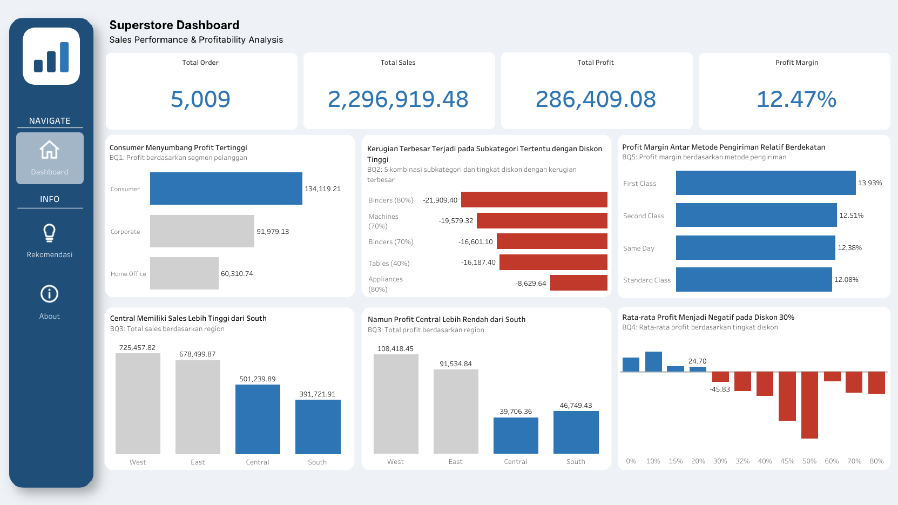

# 🛍️ Analisis Penjualan & Profitabilitas — Superstore

[](https://public.tableau.com/app/profile/reisya.junita/viz/SuperstoreDashboard_17948848132420/SuperstoreDashboard)

## 📌 Project Overview

Project ini bertujuan untuk menganalisis kinerja penjualan dan profitabilitas pada data transaksi retail Superstore periode 2014–2017. Fokus analisis adalah mengidentifikasi segmen pelanggan yang memberikan kontribusi profit terbesar, wilayah dengan performa penjualan dan profit yang berbeda, serta subkategori dan tingkat diskon yang berkaitan dengan kerugian.

Analisis dilakukan secara deskriptif menggunakan **MySQL** untuk data preparation dan business analysis, **Python** untuk Exploratory Data Analysis (EDA) dan visualisasi, serta **Tableau** untuk membangun dashboard interaktif.

## 📌 Business Questions

1. Segmen pelanggan apa yang memberikan kontribusi profit paling tinggi?
2. Kategori dan sub kategori apa saja yang paling banyak menghasilkan kerugian (profit negatif) akibat strategi pemberian diskon?
3. Apakah wilayah geografis dengan jumlah penjualan tertinggi selalu menghasilkan profit yang lebih tinggi?
4. Berapa batas persentase diskon maksimal (threshold) yang masih menghasilkan profit positif berdasarkan data?
5. Apakah terdapat perbedaan profitabilitas antar metode pengiriman?

## 🔍 Key Findings

1. **Customer Segment:** Segmen **Consumer** menghasilkan total profit tertinggi sebesar **134,119.21**. Namun, segmen **Home Office** memiliki profit margin tertinggi sebesar **14.05%**, dibandingkan Corporate sebesar 13.03% dan Consumer sebesar 11.55%. Total profit Consumer sejalan dengan jumlah pesanannya yang paling banyak **(2,586)**.

2. **Category & Discount:** Kerugian terkonsentrasi pada subkategori tertentu, terutama pada tingkat diskon 70%-80%. **Binders** mencatat kerugian sebesar **-21,909.40** dengan profit margin -161.32%, sedangkan **Appliances** mengalami kerugian sebesar **-8,629.64** dengan profit margin -255.12%. **Machines** pada diskon 70% juga mencatat kerugian besar sebesar -19,579.32. Meskipun demikian, kategori **Office Supplies** secara keseluruhan tetap menghasilkan total profit positif sebesar **122,490.80**.

3. **Regional Performance:** Region **West** mencatat total sales dan profit tertinggi, masing-masing sebesar **725,457.82** dan **108,418.45**. Sementara itu, peringkat sales dan profit tidak selalu sama pada seluruh region. **Central** memiliki sales lebih tinggi daripada South, tetapi profit-nya lebih rendah.

4. **Discount Threshold:** Diskon **20%** merupakan tingkat diskon tertinggi yang masih menunjukkan rata-rata profit positif sebesar **24.70** dan total profit **90,337.31**. Pada diskon **30%**, rata-rata profit menjadi negatif sebesar **-45.83**, dengan **91.59%** baris transaksi mengalami kerugian. Karena tidak terdapat tingkat diskon antara 20% dan 30% pada data, batas threshold yang tepat belum dapat ditentukan.

5. **Shipping Mode:** Profit margin antar metode pengiriman berada pada rentang **12.08%–13.93%**. First Class memiliki profit margin tertinggi sebesar **13.93%**, sedangkan Standard Class menghasilkan total profit terbesar sebesar **164,100.85**, terutama karena memiliki jumlah baris transaksi paling banyak.

## 🛠️ Tools & Technologies

**Database & SQL**
- MySQL: Data ingestion, staging, data mart, dan business analysis.

**Python (Jupyter Notebook)**
- `pandas` & `numpy`: Data profiling, cleaning, dan manipulation.
- `sqlalchemy` & `pymysql`: Database connection.
- `python-dotenv`: Environment variable management.
- `matplotlib` & `seaborn`: Data visualization.

**Data Visualization**
- Tableau Public: Interactive dashboard.

## 📁 Project Structure

```text
superstore_analysis/
│
├── data/
│   ├── raw/
│   │   └── superstore.csv
│   │
│   └── processed/
│       ├── bq1_customer_segment.csv
│       ├── bq2_category_loss.csv
│       ├── bq3_region_performance.csv
│       ├── bq4_discount_threshold.csv
│       └── bq5_ship_mode_profit.csv
│
├── docs/
│   ├── images/
│   │   ├── grafik_bq1.png
│   │   ├── grafik_bq2.png
│   │   ├── grafik_bq3.png
│   │   ├── grafik_bq4.png
│   │   ├── grafik_bq5.png
│   |   └── superstore_dashboard.png
│   │
│   ├── business_report.md
│   └── data_dictionary.md
│
├── notebooks/
│   ├── 01_eda.ipynb
│   └── 02_visualization.ipynb
│
├── sql/
│   ├── 01_setup/
│   │   ├── 00_database_setup.sql
│   │   └── 01_load_raw_data.sql
│   │
│   ├── 02_staging/
│   │   └── 02_stg_superstore.sql
│   │
│   └── 03_analysis/
│       ├── 03_BQ1_customer_segment.sql
│       ├── 04_BQ2_category_loss.sql
│       ├── 05_BQ3_region_performance.sql
│       ├── 06_BQ4_discount_threshold.sql
│       └── 07_BQ5_ship_mode_profit.sql
│
├── requirements.txt
├── .env
├── .gitignore
└── README.md
```

## ⚙️ Cara Menjalankan Project

### 1. Clone Repository

```bash
git clone https://github.com/reisyajunita/superstore-analysis.git
cd superstore-analysis
```

### 2. Install Dependencies

```bash
pip install -r requirements.txt
```

### 3. Konfigurasi Environment Variables

Buat file `.env` di root folder project dan isi dengan konfigurasi koneksi MySQL:

```env
DB_HOST=localhost
DB_USER=root
DB_PASSWORD=your_password
DB_PORT=3306
DB_NAME=superstore_db
```

Sesuaikan nilai konfigurasi dengan pengaturan MySQL pada komputer masing-masing.

### 4. Siapkan Dataset

Letakkan file `superstore.csv` di dalam folder `data/raw/`.

Sesuaikan lokasi file CSV pada script `sql/01_setup/01_load_raw_data.sql` dengan lokasi file di komputer masing-masing.

### 5. Jalankan SQL Scripts

Jalankan file SQL secara berurutan sesuai tahapan berikut:

1. `sql/01_setup/00_database_setup.sql` — Membuat database dan struktur awal.
2. `sql/01_setup/01_load_raw_data.sql` — Memuat data mentah ke database.
3. `sql/02_staging/02_stg_superstore.sql` — Melakukan data cleaning dan membangun tabel staging.
4. `sql/03_analysis/` — Menjalankan query analisis untuk BQ1 sampai BQ5.

### 6. Jalankan Jupyter Notebook

Buka notebook sesuai urutan:

- `01_eda.ipynb` — Exploratory Data Analysis dan pemeriksaan karakteristik data.
- `02_visualization.ipynb` — Visualisasi hasil analisis dan penyusunan insight berdasarkan Business Questions.

## 📄 Project Documentation & Dashboard

- [Business Report](docs/business_report.md)
- [Data Dictionary](docs/data_dictionary.md)
- [Tableau Public Dashboard](https://public.tableau.com/app/profile/reisya.junita/viz/SuperstoreDashboard_17948848132420/SuperstoreDashboard)

## 📊 Dataset

Dataset yang digunakan dalam project ini adalah Superstore Dataset dengan periode transaksi 2014–2017.

- [Superstore Dataset — Kaggle](https://www.kaggle.com/datasets/vivek468/superstore-dataset-final)