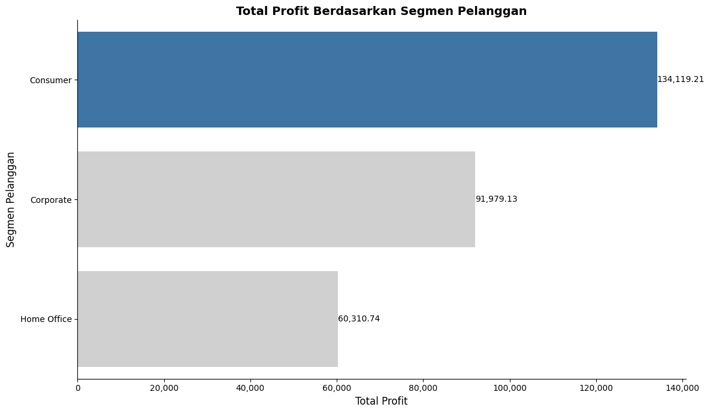
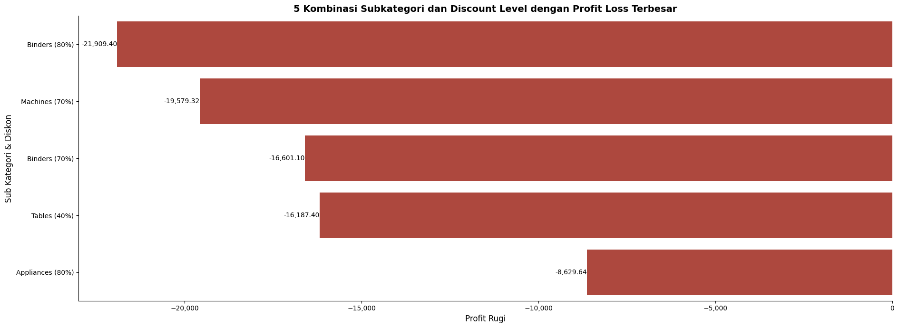
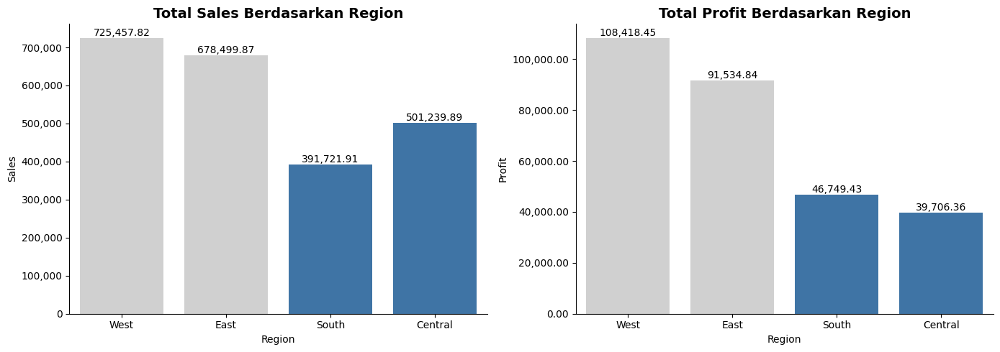
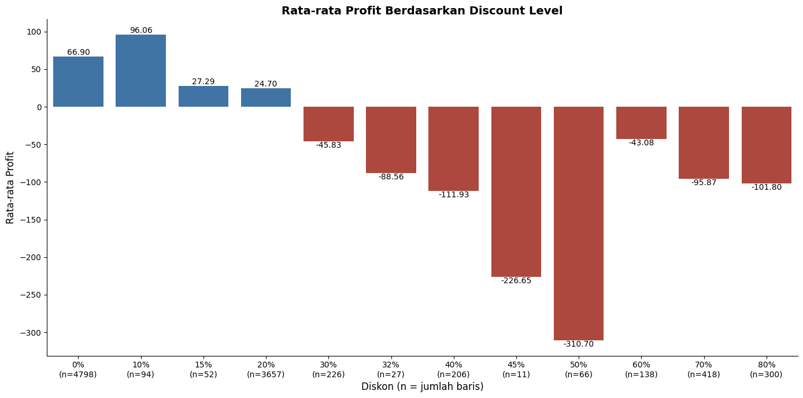
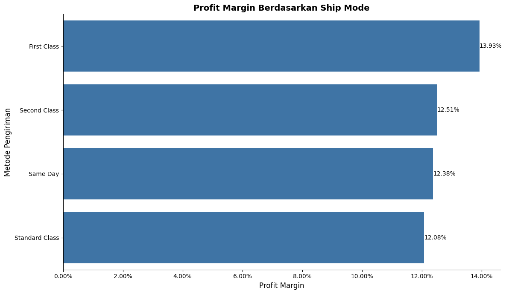

# Business Report - Superstore Sales Performance & Profitability Analysis

## Executive Summary
Analisis ini bertujuan untuk mengidentifikasi pola kerugian dan mengevaluasi profitabilitas berdasarkan tingkat diskon, kategori produk, segmen pelanggan, wilayah, dan metode pengiriman.

Hasil analisis menunjukkan bahwa diskon 20% merupakan tingkat diskon tertinggi yang masih menghasilkan rata-rata profit positif sebesar 24.70, dengan total profit 90,337.31 dan persentase baris rugi sebesar 13.73%. Sebaliknya, pada diskon 30%, rata-rata profit menjadi negatif sebesar -45.83 dan persentase baris rugi meningkat menjadi 91.59%.

Kerugian juga terkonsentrasi pada subkategori tertentu. Pada diskon 80%, Binders mengalami kerugian nominal terbesar sebesar -21,909.40 dengan profit margin -161.32%, sedangkan Appliances memiliki profit margin terendah sebesar -255.12% dengan nominal kerugian -8,629.64. Machines pada diskon 70% juga mencatat kerugian nominal yang besar yaitu -19,579.32. Meskipun demikian, kategori Office Supplies secara keseluruhan tetap menghasilkan total profit positif sebesar 122,490.80.

Selain itu, hasil analisis menunjukkan bahwa wilayah dengan total sales lebih tinggi belum tentu menghasilkan total profit lebih tinggi. Sementara itu, profitabilitas antar-metode pengiriman relatif serupa berdasarkan profit margin dan rata-rata profit.

Berdasarkan temuan tersebut, perusahaan disarankan untuk mengevaluasi pemberian diskon di atas 20%, terutama pada subkategori yang menunjukkan kerugian pada tingkat diskon tinggi. Angka 20% digunakan sebagai acuan evaluasi berdasarkan data yang tersedia, bukan sebagai batas aman universal.

---

## 1. Business Context (Konteks Bisnis)
Sebuah perusahaan retail berskala besar (Superstore) menghadapi persaingan pasar yang semakin ketat. Untuk mempertahankan pangsa pasar dan volume penjualan, Superstore menerapkan berbagai strategi promosi dan pemberian diskon di berbagai wilayah dan kategori produk.

Menjaga keseimbangan antara volume penjualan (sales) dan margin keuntungan (profit) merupakan salah satu aspek penting dalam keberlanjutan bisnis. Oleh karena itu, diperlukan evaluasi terhadap performa penjualan dan profitabilitas untuk memahami efektivitas strategi diskon serta faktor-faktor lain yang berkaitan dengan kinerja bisnis.

---

## 2. Business Problem (Masalah Bisnis)
Meskipun perusahaan menghasilkan penjualan dalam jumlah besar, terdapat transaksi-transaksi tertentu yang menghasilkan kerugian (profit negatif), bahkan hingga lebih dari $6,000 pada satu transaksi.

Indikasi awal menunjukkan bahwa kerugian tersebut muncul pada tingkat diskon yang tinggi, termasuk mencapai 80%. Namun, perusahaan perlu memahami secara lebih terperinci pada tingkat diskon, kategori produk, subkategori, dan wilayah mana kerugian tersebut terkonsentrasi.

Oleh karena itu, diperlukan analisis untuk mengidentifikasi pola kerugian dan mengevaluasi profitabilitas agar perusahaan dapat merumuskan strategi pemberian diskon dan penargetan pelanggan yang lebih efektif.

---

## 3. Business Objective (Tujuan Bisnis)
Tujuan analisis ini adalah mengidentifikasi pola kerugian dan mengevaluasi profitabilitas berdasarkan tingkat diskon, segmen pelanggan, kategori produk, wilayah geografis, dan metode pengiriman sehingga perusahaan dapat mengambil keputusan yang lebih tepat dalam merumuskan strategi penjualan dan pemberian diskon.

---

## 4. Business Questions (Pertanyaan Bisnis)
1. Segmen pelanggan apa yang memberikan kontribusi profit paling tinggi?
2. Kategori dan sub kategori apa saja yang paling banyak menghasilkan kerugian (profit negatif) akibat strategi pemberian diskon?
3. Apakah wilayah geografis dengan jumlah penjualan tertinggi selalu menghasilkan profit yang lebih tinggi?
4. Berapa batas persentase diskon maksimal (threshold) yang masih menghasilkan profit positif berdasarkan data?
5. Apakah terdapat perbedaan profitabilitas antar metode pengiriman?

---

## 5. Dataset Overview
- **Sumber Data:** [Superstore Dataset](https://www.kaggle.com/datasets/vivek468/superstore-dataset-final)
- **Deskripsi:** Dataset berisi data transaksi penjualan retail Superstore, mencakup informasi pelanggan, produk, wilayah, metode pengiriman, diskon, penjualan, dan profit dengan rentang waktu Januari 2014 sampai Desember 2017.
- **Jumlah Data:** 9,994 baris data asli, menjadi 9,993 baris pada tahap staging setelah satu baris duplikat dihapus.
- **Grain Analisis Utama:** Tingkat item produk per pesanan. Satu baris data mewakili satu jenis produk yang dibeli dalam satu transaksi.

---

## 6. Methodology
- **Jenis Analisis:** Analisis deskriptif untuk membandingkan performa penjualan dan profit antar-kelompok berdasarkan segmen pelanggan, kategori produk, wilayah, diskon, dan metode pengiriman. Analisis ini menggunakan data historis tanpa melakukan prediksi maupun membuktikan hubungan sebab-akibat.
- **Tools:**
  - **Database & SQL:** MySQL (Staging, Mart, & Analysis)
  - **Python (Jupyter Notebook):**
    - `pandas` & `numpy`: Data profiling & manipulation
    - `sqlalchemy` & `pymysql`: Database connection
    - `python-dotenv`: Environment variable management
    - `matplotlib` & `seaborn`: Data visualization
  - **Visualization:** Tableau (Interactive Dashboard)
- **Pendekatan Pengolahan Data:**
  - **Raw:** Data mentah dari `superstore.csv` diimpor ke MySQL menggunakan `LOAD DATA INFILE` ke tabel `superstore`, dengan seluruh kolom bertipe `TEXT` tanpa perubahan.
  - **Staging:** Data dibersihkan dan kolom yang relevan dipilih ke tabel `stg_superstore`. Proses mencakup perbaikan tipe data, konversi format tanggal, dan penghapusan baris duplikat.
  - **Mart:** Hasil agregasi untuk setiap business question disimpan sebagai tabel `mart_`, satu tabel untuk setiap BQ, sehingga notebook dan dashboard menggunakan sumber data yang sama.
  - **Visualisasi:** Tabel mart dibaca ke notebook menggunakan SQLAlchemy untuk menghasilkan grafik, kemudian hasil analisis divisualisasikan melalui dashboard Tableau.
- **Pembersihan Data:**
  - Format tanggal Amerika (MM/DD/YYYY) diubah ke tipe `DATE`, dan kolom numerik diubah dari teks menjadi angka.
  - Nilai kosong diubah menjadi `NULL`.
  - Ditemukan satu pasang baris identik pada seluruh kolom kecuali `row_id`, kemudian satu baris dihapus saat staging (9,994 menjadi 9,993 baris). `row_id` dikecualikan saat pemeriksaan karena nomor urut selalu unik.
  - Kolom `row_id`, `city`, dan `postal_code` tidak dibawa ke staging karena tidak digunakan dalam analisis.
  - Nilai profit minus ekstrem (hingga -$6,599.98) dipertahankan karena merupakan bagian dari data transaksi dan relevan untuk analisis kerugian.
- **Definisi Metrik:**
  - **Profit margin:** total profit dibagi total sales, kemudian dikalikan 100.
  - **Persentase baris rugi:** jumlah baris dengan profit negatif dibagi total baris pada tingkat diskon yang sama, kemudian dikalikan 100.
  - **Acuan diskon BQ4:** tingkat diskon dengan rata-rata profit dan total profit positif serta persentase baris rugi yang relatif lebih rendah dibandingkan tingkat diskon berikutnya yang tersedia pada dataset.

---

## 7. Key Findings

### BQ1: Segmen Pelanggan dengan Profit Tertinggi
**Fakta:** Segmen Consumer memberikan total profit tertinggi sebesar 134,119.21. Namun, Home Office memiliki profit margin tertinggi sebesar 14.05%, diikuti Corporate sebesar 13.03% dan Consumer sebesar 11.55%.

Total profit nominal Consumer yang paling besar sejalan dengan jumlah pesanannya yang paling banyak yaitu 2,586, dibandingkan Corporate (1,514) dan Home Office (909). Selisih profit margin antar segmen adalah 2.50 poin persentase antara yang tertinggi dan terendah.

**Insight:** Consumer memberikan kontribusi profit nominal terbesar, sedangkan Home Office memiliki profitabilitas relatif terhadap sales yang paling tinggi. Dengan demikian, besarnya total profit tidak selalu menunjukkan tingginya profit margin suatu segmen.

---

### BQ2: Subkategori yang Mengalami Kerugian Akibat Diskon
**Fakta:** Kerugian profit nominal terbesar terdapat pada kategori Office Supplies, subkategori Binders, sebesar -21,909.40 pada diskon 80%, dengan profit margin -161.32%.

Sementara itu, subkategori Appliances pada kategori Office Supplies memiliki profit margin terendah sebesar -255.12%, dengan nominal kerugian sebesar -8,629.64 pada diskon 80%.

Lima kombinasi dengan kerugian profit nominal terbesar adalah Binders (80%), Machines (70%), Binders (70%), Tables (40%), dan Appliances (80%). Machines pada diskon 70% mencatat kerugian sebesar -19,579.32 dengan profit margin -125.50%.

**Insight:** Kerugian terkonsentrasi pada subkategori tertentu yang menerima diskon tinggi, terutama pada tingkat diskon 70%-80%, bukan pada kategori secara keseluruhan. Hal ini terlihat dari kategori Office Supplies yang secara keseluruhan tetap menghasilkan total profit positif sebesar 122,490.80. Meskipun demikian, Tables pada diskon 40% juga termasuk lima kombinasi dengan kerugian nominal terbesar (-16,187.40) sehingga kerugian tidak sepenuhnya terbatas pada diskon 70%-80%.

---

### BQ3: Hubungan Penjualan dengan Profit per Wilayah
**Fakta:** West memiliki total sales tertinggi sebesar 725,457.82 dan total profit tertinggi sebesar 108,418.45, diikuti East dengan total sales 678,499.87 dan total profit 91,534.84.

Urutan Central dan South berbeda antara total sales dan total profit. Central memiliki total sales lebih tinggi (501,239.89 dibandingkan 391,721.91), tetapi total profit lebih rendah (39,706.36 dibandingkan 46,749.43).

**Insight:** Besarnya total sales saja tidak cukup untuk menilai performa suatu wilayah karena wilayah dengan total sales lebih tinggi belum tentu menghasilkan total profit yang lebih tinggi.

---

### BQ4: Batas Diskon Maksimal dengan Profit Positif
**Fakta:** Diskon 20% merupakan tingkat diskon tertinggi yang masih menghasilkan rata-rata profit positif sebesar 24.70 dan total profit sebesar 90,337.31. Persentase baris rugi sebesar 13.73% (502 dari 3,657 baris), jauh lebih rendah dibandingkan diskon 30% yang sebesar 91.59%.

Sebaliknya, diskon 30% menghasilkan rata-rata profit negatif sebesar -45.83, total profit sebesar -10,357.22, dan persentase baris rugi sebesar 91.59% (207 dari 226 baris).

Tidak terdapat data diskon di antara 20% dan 30%, sehingga batas persis perubahan profitabilitas tidak dapat ditentukan.

**Insight:** Perbedaan persentase baris rugi antara diskon 20% dan 30% menunjukkan perubahan pola profitabilitas yang cukup tajam pada tingkat diskon yang tersedia. Oleh karena itu, diskon di atas 20% perlu dievaluasi lebih lanjut.

---

### BQ5: Pengaruh Metode Pengiriman terhadap Profitabilitas
**Fakta:** Profit margin antar-metode pengiriman berada pada rentang 12.08%-13.93%, sedangkan rata-rata profit berada pada rentang 27.50-31.84.

Standard Class menghasilkan total profit tertinggi sebesar 164,100.85 dengan jumlah baris transaksi terbanyak, yaitu 5,967 baris.

**Insight:** Profitabilitas antar-metode pengiriman relatif serupa berdasarkan profit margin dan rata-rata profit. Standard Class memiliki total profit tertinggi, tetapi hal tersebut sejalan dengan jumlah baris transaksinya yang paling banyak, bukan berarti metode ini memiliki profitabilitas tertinggi.

---

## 8. Recommendation
1. **Evaluasi pemberian diskon di atas 20%:** Gunakan diskon 20% sebagai acuan awal evaluasi karena pada data yang tersedia tingkat diskon 30% sudah menunjukkan rata-rata profit negatif dan persentase baris rugi yang tinggi. Namun, angka 20% tidak dapat dianggap sebagai batas aman universal. (Dasar: BQ4)

2. **Evaluasi diskon tinggi pada subkategori tertentu:** Prioritaskan pemeriksaan terhadap subkategori yang menunjukkan kerugian terbesar, terutama Binders (diskon 70% dan 80%), Machines (diskon 70%), dan Appliances (diskon 80%), serta subkategori lain yang menunjukkan pola kerugian pada diskon tinggi. Evaluasi perlu dilakukan pada tingkat produk dan transaksi sebelum mengubah kebijakan diskon secara menyeluruh. (Dasar: BQ2)

3. **Pertahankan evaluasi metode pengiriman berdasarkan metrik profitabilitas:** Jangan menjadikan total profit Standard Class sebagai satu-satunya dasar untuk menentukan metode pengiriman paling menguntungkan. Bandingkan profit margin dan rata-rata profit, serta pertimbangkan faktor operasional lain sebelum mengubah strategi pengiriman. (Dasar: BQ5)

---

## 9. Limitations
1. Analisis bersifat deskriptif sehingga tidak dapat membuktikan hubungan sebab-akibat antara diskon, metode pengiriman, dan profitabilitas.

2. Tidak terdapat data diskon di antara 20% dan 30%, sehingga threshold perubahan profitabilitas secara tepat belum dapat ditentukan.

3. Analisis kerugian pada BQ2 berfokus pada kombinasi kategori, subkategori, dan tingkat diskon tertentu. Hasilnya tidak merepresentasikan keseluruhan performa kategori produk.

4. Analisis BQ3 menunjukkan perbedaan urutan sales dan profit antarwilayah, tetapi tidak mengidentifikasi faktor penyebab perbedaan tersebut.

5. Analisis BQ5 tidak menggunakan uji statistik, sehingga perbedaan profitabilitas antar-metode pengiriman belum dapat dinyatakan signifikan atau tidak signifikan secara statistik.

---

## 10. Dashboard
Hasil analisis divisualisasikan dalam dashboard interaktif menggunakan Tableau Public.

**Tableau Public:**
https://public.tableau.com/app/profile/reisya.junita/viz/SuperstoreDashboard_17948848132420/SuperstoreDashboard